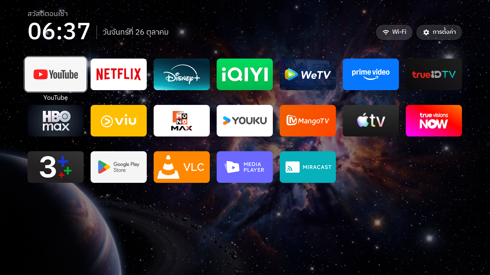
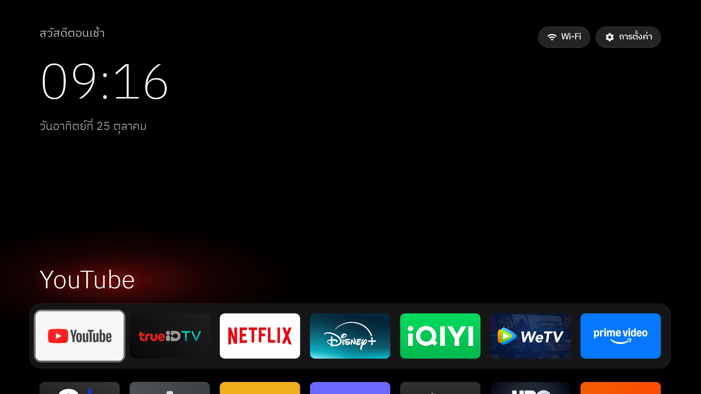
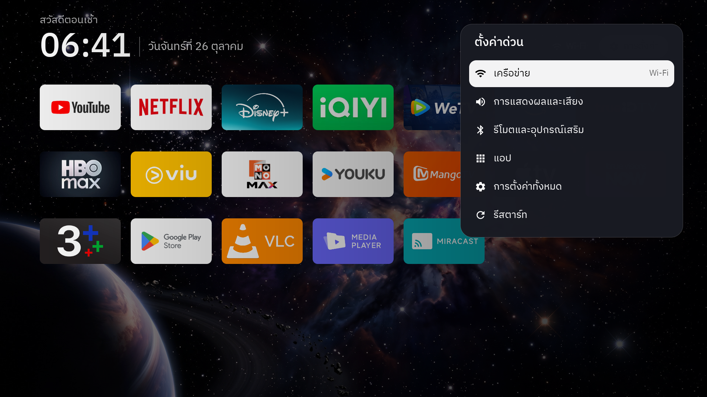

# Xiaomi TV Box S 3rd Gen — debloat + S3 Home launcher

Device: MiTV-AFMU0, Google TV, Android 14 (SDK 34), firmware V816.0.11.0.UZFAABX.
Set up 2026-10-25. Original state before any change: `backup\`.

## Showcase

**Home: app list only** (`dock_enabled` false): fixed header with greeting, time and date, Wi-Fi and
Settings pills, all apps in one grid over a wallpaper (`space`); the focused tile grows and shows its name.



**Home with the dock** (`dock_enabled` true): dock band with the big name of the focused app and a glow
in the colour of its banner, the grid below it (shown on a plain black background).



**Quick settings** (hold Home on the remote): Network, Display & sound, Remotes & accessories, Apps,
All settings and Restart, over whatever is on screen.



## What was changed

**Disabled** with `pm disable-user --user 0` (nothing uninstalled), full list in `disabled-packages.txt`:

| Group                | Packages                                                                                                                                |
| -------------------- | --------------------------------------------------------------------------------------------------------------------------------------- |
| Telemetry            | `com.miui.tv.analytics`, `com.xiaomi.statistic`, `com.android.tv.feedbackconsent`, `com.google.android.feedback`                        |
| Xiaomi content / ads | `com.mitv.tvhome.michannel`, `com.mitv.tvhome.oemtab`, `com.xm.webcontent`, `com.xiaomi.android.tvsetup.partnercustomizer`              |
| Unused preloads      | `com.xiaomi.mimusic2`, `com.google.android.play.games`                                                                                  |
| Launcher takeover    | `com.google.android.apps.tv.launcherx` (Google TV home), `com.google.android.tungsten.setupwraith` (setup wizard, grabs Home otherwise) |

Google's screensaver Backdrop (`com.google.android.apps.tv.dreamx`) was disabled at first and is
**enabled again**: it is the box's only screensaver (`screensaver_default_component`), so with it off
the box had none.

Kept on purpose: Google Assistant, Chromecast, Xiaomi casting / Miracast, firmware updates, YouTube,
Netflix, Prime Video, YouTube Music, `mitv.service` (remote keys), Bluetooth, Play Store / Services.

**Other settings**

- Location **on** (was off), so the Wi-Fi pill can show the network name. Only S3 Home has the permission.
- Remote-button helper **on** (accessibility service "S3 Home remote buttons"): YouTube button opens
  YouTube, holding Home opens Settings. **Trade-off:** held buttons don't repeat - volume and D-pad
  move one step per press.
- Private DNS: AdGuard (`dns.adguard-dns.com`) was **already set before this project** and was left alone.
  It blocks many ad/tracker domains, not YouTube ads. Undo: `adb shell settings put global private_dns_mode opportunistic`.

## Connecting

Wireless debugging gets a new port after every reboot or Wi-Fi drop: read it from
Developer options → Wireless debugging, then:

```powershell
adb connect 192.168.2.5:<port>
$env:TV_SERIAL = '192.168.2.5:<port>'    # all scripts use it (or pass -Serial)
```

## Re-enable one app

```powershell
adb -s $env:TV_SERIAL shell pm enable --user 0 <package>
```

Then delete its line from `disabled-packages.txt`. List what is disabled: `adb shell pm list packages -d`.
Re-enabling `com.google.android.apps.tv.launcherx` gives Home back to Google TV straight away.

## Undo everything

```powershell
.\restore.ps1                 # add -KeepLauncher to leave S3 Home installed
adb -s $env:TV_SERIAL reboot
```

Re-enables every package in `disabled-packages.txt`, switches the remote-button helper and location off,
gives Home back to Google TV and uninstalls S3 Home.

## Change the dock, the grid or the wallpaper

Edit `launcher\app\src\main\res\values\config.xml`, then rebuild and install:

```powershell
.\install-launcher.ps1        # -BuildOnly to just build, -SetHome to also make it Home
```

- `columns` — tiles per row, 4–7 (dock and grid share it). Now 7.
- `dock_enabled` — `false` = app list only (now): no dock band, big app name or glow; all apps in one
  grid right under the header, `dock_apps` first, then `app_order`, then the rest. `true` = dock as before.
- `dock_position` — where the dock sits when Home opens: `0` = highest, `50` = middle, `100` = bottom (now `35`).
- `dock_apps` — dock apps left to right, by package name (now YouTube, TrueID TV, Netflix, Disney+,
  iQIYI, WeTV, Prime Video). Package names of installed TV apps:
  `adb shell cmd package query-activities --brief -a android.intent.action.MAIN -c android.intent.category.LEANBACK_LAUNCHER`
- `hidden_apps` — package names never shown.
- `app_order` — grid order below the dock: listed apps first, in that order; everything else
  alphabetically after them. New apps appear by themselves.
- **Theme: Aurora** (from CleanYourTV, MIT, `launcher\AURORA-WALLPAPER-LICENSE-MIT.txt`): background
  `#070A14` + `drawable-nodpi\aurora.jpg`. CleanYourTV's own `config.json` themes don't load in S3 Home;
  their values are copied into `config.xml` instead.
- `background` — colour behind everything. Pitch black again: `#000000` and an empty `wallpaper`.
- `wallpaper` — name of an image in `launcher\app\src\main\res\drawable-nodpi\` (now `space`; `aurora`
  is the CleanYourTV one). Empty = none. The launcher draws at 1920×1080, so fit new pictures first;
  a larger one only costs RAM (decoded in full every time Home starts) and APK size:
  ```powershell
  python -I tools\fit-wallpaper.py <big.jpg> launcher\app\src\main\res\drawable-nodpi\<name>.jpg
  ```
  (centre-crop to 16:9, Lanczos resize, JPEG q90). Originals are kept in `launcher\wallpaper-originals\`.
- `clock_weight` — clock thickness: `ExtraLight`, `Light`, `Regular` (now) or `Medium`.
- `wallpaper_scrim` — dark layer over the wallpaper, 0–100 % (now 50).
- `dock_opacity` — how solid the dock band is over a wallpaper, 0–100 % (now 55).
- `app_keys` — remote button → app for the helper (`190` = YouTube button).
- `long_press_ms` — how long to hold OK / Home, in milliseconds (now 400 = 0.4 seconds).
- `home_long_press` — what holding Home does: `panel` = quick settings card (now), `settings` = full
  Android Settings, empty = nothing extra. Needs the helper (below).

**Quick settings** (hold Home on the remote for 0.4 seconds, `long_press_ms`): a glass card on the right, over whatever is on
screen — Network (shows the Wi-Fi name), Display & sound, Remotes & accessories, Apps, All settings,
Restart (opens the system power menu, which asks before restarting; needs the helper).
Remotes & accessories needs the Nearby devices permission (`BLUETOOTH_CONNECT`), granted by
`install-launcher.ps1`. It opens the **device list** only if S3 Home also holds `WRITE_SECURE_SETTINGS`
(TV Settings' slice page refuses other callers); otherwise it opens main Settings, where Remotes &
accessories is one row down. That permission lets an app change system settings, so it is optional and
not granted by the script. S3 Home uses it only to open that page. To grant / take it back:

```powershell
adb -s $env:TV_SERIAL shell pm grant  com.launcher.mi.box.s3 android.permission.WRITE_SECURE_SETTINGS
adb -s $env:TV_SERIAL shell pm revoke com.launcher.mi.box.s3 android.permission.WRITE_SECURE_SETTINGS
```

Reinstalling with `install-launcher.ps1` keeps the grant; uninstalling removes it.

**USB pill:** while a USB drive is mounted, a pill with its name appears before the Wi-Fi pill and opens
`usb_app` (Mi Media Explorer). Note: the box only sees USB drives while debugging is off (see below).
Up/Down move, OK opens, Back or Left closes. It's S3 Home's own panel (`QuickPanelActivity.java`);
CleanYourTV's `settings_key_panel` belongs to a different launcher and doesn't apply here.

The helper on / off:

```powershell
# on
adb shell settings put secure enabled_accessibility_services com.launcher.mi.box.s3/com.launcher.mi.box.s3.KeyService
adb shell settings put secure accessibility_enabled 1
# off (held buttons repeat again; YouTube button and hold-Home stop working)
adb shell settings put secure enabled_accessibility_services '""'
adb shell settings put secure accessibility_enabled 0
```

Build needs the JDK bundled with Android Studio (`C:\Program Files\Android\Android Studio\jbr`, Java 25),
Gradle 8.14.3 via the wrapper (`launcher\gradlew.bat`, downloads it into `~\.gradle` on first use) and the
SDK in `D:\AndroidSDK`; the script sets them up. It installs with `push` + `pm install -r` because
`adb install` can hang on Android 14, and re-grants location.

## Using S3 Home

- D-pad: Up/Down move exactly one row; Up from the dock goes to the pills top right; the pill row
  stops at its ends; Down from the pills returns to the last tile. Back returns to the dock.
  Pressing Home while on Home jumps back to the dock.
- OK opens the app; **hold OK** on a tile opens a small menu: **Move**, **App info** (force stop,
  clear data, disable), and **Reset app order** (only once you've moved something).
- **Arrange apps on the TV:** hold OK → Move. The tile gets a bright edge and a hint appears at the top;
  ◀ ▶ step it through the list (also from the dock into the grid and back), ▲ ▼ move it a row. OK or
  Back drops it. The dock keeps its size: moving an app into it pushes the last dock app into the grid.
  The order is saved on the box and **overrides `dock_apps` / `app_order` in `config.xml`** until Reset
  app order (or `adb shell pm clear com.launcher.mi.box.s3`, which also drops its permissions).
- Pills: Wi-Fi (network name) opens network settings, Settings opens Android settings. An Inputs pill
  with an HDMI / AV / Live TV dropdown appears only on devices that have inputs (this box has none).
- Header (fixed, stays on screen while the apps scroll underneath): greeting, then time | date on one
  line; the pills sit on the time line. Greeting and date follow the system language. Font: IBM Plex Sans Thai (SIL OFL,
  `launcher\app\src\main\assets\fonts\IBMPlexSansThai-OFL.txt`).

## When you're done with ADB

Developer options → Wireless debugging **off**, USB debugging **off**, **Revoke USB debugging
authorisations**, then reboot. While Wireless debugging is on, the box's USB port runs in device mode,
so a USB drive plugged into it is not detected until debugging is off and the box has rebooted.

## Files

| Path                    | What                                                                                       |
| ----------------------- | ------------------------------------------------------------------------------------------ |
| `backup\`               | Package lists, getprop, all settings, HOME handlers, display, network (before any change)  |
| `disabled-packages.txt` | What is disabled (read by `restore.ps1`)                                                   |
| `restore.ps1`           | Undo everything                                                                            |
| `setup-new-box.ps1`     | Set up another box in one go (backup, debloat, launcher, takeover); see `HowTo.md`         |
| `OtherDevice.md`        | Using it on other Android TV / Google TV models: what works as is, what to check per model |
| `install-launcher.ps1`  | Build + install S3 Home (Windows)                                                          |
| `install-launcher.sh`   | Same for Mac/Linux: `TV_SERIAL=ip:port ./install-launcher.sh [--set-home] [--build-only]`  |
| `.gitattributes`        | Keeps `gradlew` / `*.sh` LF and `*.bat` / `*.ps1` CRLF for every clone                     |
| `tools\disable.ps1`     | Disable packages one per call; refuses Android core packages                               |
| `tools\shot.ps1`        | Press keys, then pull a screenshot: `.\tools\shot.ps1 shots\x.png DPAD_DOWN`               |
| `launcher\`             | Launcher source (Java, AndroidX RecyclerView)                                              |
| `shots\`                | Screenshots from the TV taken while setting it up                                          |

## Other

- [วิธีการใช้งานเพิ่มเติมได้ที่นี่](HowTo.md)
- [วิธีการใช้งานเครื่องรุ่นอื่นได้ที่นี่](OtherDevice.md)
